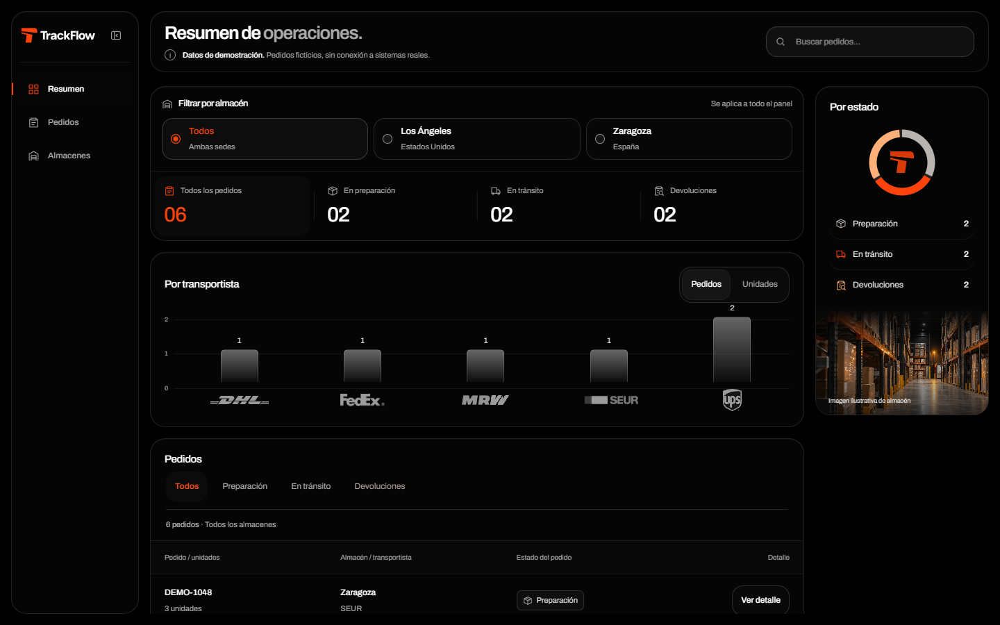
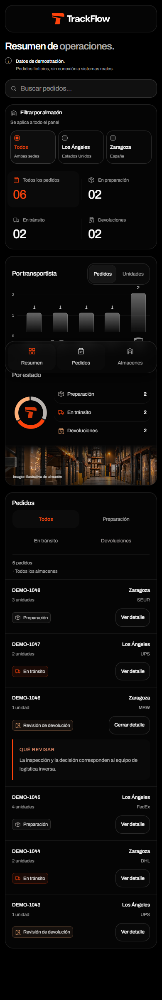

# Hito — Ingeniería impulsada por IA: TrackFlow

Requisitos consultados en el [campus de 4Geeks](https://learn.4geeks.com/es/main-cohort/spain-aie-pt-5/syllabus/working-with-ai-coding-agents-v3/project/ai-eng-milestone-ai-driven-engineering?moduleId=4).
Esta guía relaciona los requisitos con los archivos del proyecto;
no acredita una PR ni una entrega en el campus.

## Archivos de infraestructura

| Requisito | Archivo y contenido |
| --- | --- |
| Contexto de empresa | [CONTEXT.md](../CONTEXT.md): briefing de TrackFlow. |
| Negocio, objetivos y problema | [projectbrief.md](../memory-bank/projectbrief.md). |
| Stack, arquitectura y restricciones | [techContext.md](../memory-bank/techContext.md). |
| Estado y próximos pasos | [progress.md](../memory-bank/progress.md). |
| Instrucciones del agente | [AGENTS.md](../AGENTS.md): lectura inicial, seis pasos precommit y archivos protegidos. |
| Regla con alcance explícito | [company-content.md](../.agents/rules/company-content.md); [visual-identity.md](../.agents/rules/visual-identity.md) para UI. |
| Skill recurrente verificable | [SKILL.md](../.agents/skills/update-project-memory/SKILL.md): objetivo, entradas, procedimiento, salida y aceptación. |

## Aplicaciones

- [Website](../uis/website/README.md): entrada `/`, contenido corporativo
  de TrackFlow y componentes reutilizables.
- [Backoffice](../uis/backoffice/README.md): entrada `/`, layout propio,
  sedes y procesos de TrackFlow visibles, con pedidos ficticios identificados.
- Ambas apps están bajo `uis`; recursos comunes en `shared/brand`.
  No hay backend implementado. Los servicios futuros deben ir en `services`.

Desde la raíz, abrir un terminal por aplicación:

```bash
cd uis/website
pnpm install --frozen-lockfile
pnpm dev --host 0.0.0.0 --port 5173 --strictPort
```

```bash
cd uis/backoffice
pnpm install --frozen-lockfile
pnpm dev
```

Abrir los puertos privados 5173 y 5174. Los README documentan las comprobaciones.

## Verificaciones

El 11/10/2026 se comprobaron lint/build de ambas apps y las cuatro pruebas SEO
correctamente en local y Codespaces. Se revisaron escritorio y móvil de 390px,
menú, filtros, búsqueda y detalles; no se observaron overflow ni errores de consola.
Resultados y limitaciones en [progress.md](../memory-bank/progress.md).
Antes del commit de entrega se repitieron lint/build y las cuatro pruebas SEO
en local y Codespaces. Se revisaron ambas apps a 1920px y 390px, sin overflow
ni errores de consola observados; menú móvil, filtros, búsqueda y detalle comprobados.

## Entrega pendiente

Fork creado: [rogerdevmtz/ai-engineering-trackflow](https://github.com/rogerdevmtz/ai-engineering-trackflow).
Origin apunta al fork en local y Codespaces; upstream conserva el original de 4Geeks.

1. Seguir AGENTS.md antes del commit final en `feature/agent-memory-bank`.
2. Abrir PR hacia `main` del fork con capturas de las dos apps y enlace directo
   a AGENTS.md en la rama entregada. Comprobar que el revisor puede abrirlos.
3. Entregar la URL de la PR en el campus.

El orden histórico de preparación antes del código no puede acreditarse
solo con el árbol actual. Las casillas del campus no sustituyen la entrega.

## Capturas preparadas

Capturas renderizadas en local conservadas en `docs/evidence`.
Al preparar la PR, comprobar que siguen representando la versión entregada.





